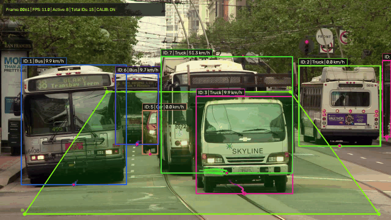
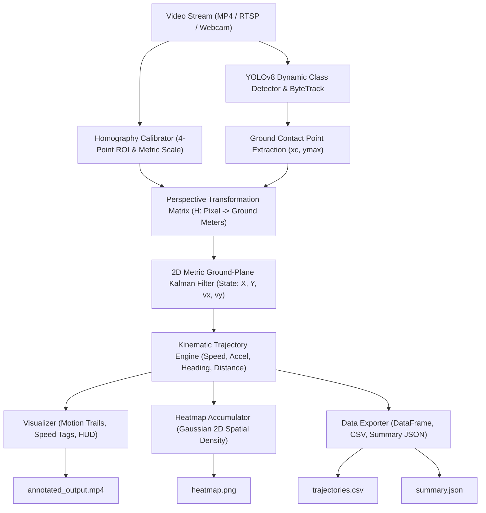
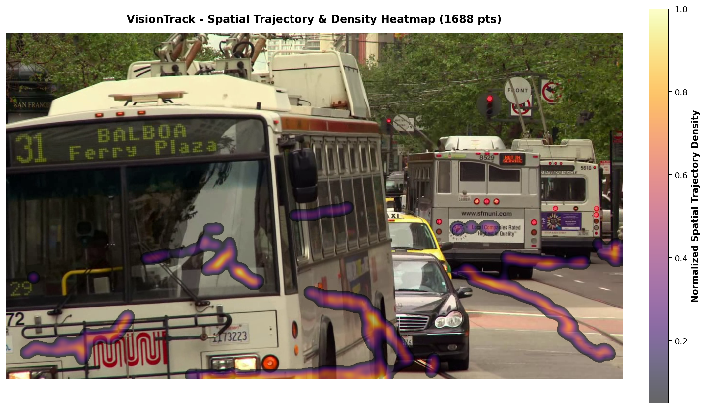

# VisionTrack: Automated Multi-Object Detection, Homography-Calibrated Tracking, and Kinematic Trajectory Extraction Engine

[](https://www.python.org/downloads/)
[](https://github.com/ultralytics/ultralytics)
[](https://github.com/ifzhang/ByteTrack)
[](visiontrack/kalman.py)
[](tests/)
[](LICENSE)

<p align="center">
  
</p>

VisionTrack is an end-to-end, production-grade computer vision pipeline designed for intelligent transportation systems (ITS), traffic monitoring, and pedestrian trajectory analysis. It ingests video streams (MP4/AVI files, RTSP streams, or live webcams), performs robust multi-class detection and tracking with persistent track IDs, projects image coordinates to metric real-world ground coordinates via perspective homography, computes optimal smoothed kinematic parameters (velocity, acceleration, heading, cumulative distance) via a **2D Metric Ground-Plane Kalman Filter**, renders dynamic visual analytics (fading motion trails, telemetry tags, and 2D spatial occupancy heatmaps), and exports structured tabular datasets.

---

## System Architecture

The pipeline is organized into six modular subsystems:



---

## Mathematical Formulations

### 1. Perspective Homography Transformation
The planar homography relates 2D image pixel coordinates $\mathbf{x} = [u, v, 1]^T$ to real-world ground metric coordinates $\mathbf{X} = [X, Y, 1]^T$ through an invertible $3 \times 3$ projective matrix $\mathbf{H}$:

$$
\begin{pmatrix} X' \\ Y' \\ W' \end{pmatrix} = \mathbf{H} \begin{pmatrix} u \\ v \\ 1 \end{pmatrix} = \begin{pmatrix}
h_{11} & h_{12} & h_{13} \\
h_{21} & h_{22} & h_{23} \\
h_{31} & h_{32} & h_{33}
\end{pmatrix} \begin{pmatrix} u \\ v \\ 1 \end{pmatrix}
$$

The inhomogeneous real-world Cartesian ground coordinates (in meters) are obtained by dividing by the projective scale factor $W'$:

$$
X = \frac{X'}{W'} = \frac{h_{11} u + h_{12} v + h_{13}}{h_{31} u + h_{32} v + h_{33}}, \qquad Y = \frac{Y'}{W'} = \frac{h_{21} u + h_{22} v + h_{23}}{h_{31} u + h_{32} v + h_{33}}
$$

Given four non-collinear image coordinate points $(u_i, v_i)$ and their corresponding known ground metric coordinates $(X_i, Y_i)$ ($i \in \{1, 2, 3, 4\}$), $\mathbf{H}$ is solved via Singular Value Decomposition (SVD) through OpenCV's `cv2.getPerspectiveTransform()`.

### 2. Ground Contact Point (Foot-Point) Extraction
Because bounding boxes enclose 3D vehicle or pedestrian volumes in a 2D perspective view, the top and centroid of the box suffer severe parallax error. The actual ground contact occurs at the bottom center of the bounding box:

$$
x_c = \frac{x_1 + x_2}{2}, \qquad y_c = y_2
$$

This $(x_c, y_c)$ pixel coordinate is mapped to $(X, Y)$ on the ground plane.

### 3. Recursive Bayesian State Estimation (Metric Ground-Plane Kalman Filter)
To eliminate detector bounding-box jitter and handle temporary occlusions, VisionTrack implements a 2D Constant Velocity (CV) Kalman Filter formulated directly in metric physical space (meters and meters/second):

$$
\mathbf{x}_k = \begin{bmatrix} X & Y & \dot{X} & \dot{Y} \end{bmatrix}^T \in \mathbb{R}^4
$$

**State Transition Model:**

$$
\mathbf{F}(\Delta t) = \begin{bmatrix}
1 & 0 & \Delta t & 0 \\
0 & 1 & 0 & \Delta t \\
0 & 0 & 1 & 0 \\
0 & 0 & 0 & 1
\end{bmatrix}, \qquad
\mathbf{H}_{\text{meas}} = \begin{bmatrix}
1 & 0 & 0 & 0 \\
0 & 1 & 0 & 0
\end{bmatrix}
$$

**Continuous White Noise Acceleration (CWNA) Process Noise $\mathbf{Q}(\Delta t)$:**

$$
\mathbf{Q} = \begin{bmatrix}
\frac{\Delta t^4}{4} & 0 & \frac{\Delta t^3}{2} & 0 \\
0 & \frac{\Delta t^4}{4} & 0 & \frac{\Delta t^3}{2} \\
\frac{\Delta t^3}{2} & 0 & \Delta t^2 & 0 \\
0 & \frac{\Delta t^3}{2} & 0 & \Delta t^2
\end{bmatrix} \sigma_a^2
$$

**Predict-Update Recursion with Joseph-Form Stability:**

$$
\begin{aligned}
\mathbf{x}_{k|k-1} &= \mathbf{F} \mathbf{x}_{k-1|k-1} \\
\mathbf{P}_{k|k-1} &= \mathbf{F} \mathbf{P}_{k-1|k-1} \mathbf{F}^T + \mathbf{Q} \\
\mathbf{K}_k &= \mathbf{P}_{k|k-1} \mathbf{H}_{\text{meas}}^T (\mathbf{H}_{\text{meas}} \mathbf{P}_{k|k-1} \mathbf{H}_{\text{meas}}^T + \mathbf{R})^{-1} \\
\mathbf{x}_{k|k} &= \mathbf{x}_{k|k-1} + \mathbf{K}_k (\mathbf{z}_k - \mathbf{H}_{\text{meas}} \mathbf{x}_{k|k-1}) \\
\mathbf{P}_{k|k} &= (\mathbf{I} - \mathbf{K}_k \mathbf{H}_{\text{meas}}) \mathbf{P}_{k|k-1} (\mathbf{I} - \mathbf{K}_k \mathbf{H}_{\text{meas}})^T + \mathbf{K}_k \mathbf{R} \mathbf{K}_k^T
\end{aligned}
$$

### 4. Euclidean Velocity, Acceleration & Heading Angle
Filtered velocity components yield scalar ground speed:

$$
v_{\text{mps}, t} = \sqrt{\dot{X}_t^2 + \dot{Y}_t^2} \quad [\text{m/s}], \qquad v_{\text{km/h}, t} = v_{\text{mps}, t} \times 3.6 \quad [\text{km/h}]
$$

Acceleration is computed from the filtered speed sequence:

$$
a_t = \frac{v_{\text{mps}, t} - v_{\text{mps}, t-1}}{\Delta t} \quad [\text{m/s}^2]
$$

The instantaneous movement direction angle $\theta \in [0^\circ, 360^\circ)$ relative to the ground coordinate axis is computed via:

$$
\theta_t = \left(\text{atan2}(\dot{Y}_t, \dot{X}_t) \cdot \frac{180}{\pi} + 360^\circ\right) \pmod{360^\circ}
$$

### 5. Savitzky-Golay Kinematic Smoothing (Fallback Mode)
When running with `--no-kalman`, a Savitzky-Golay digital filter convolves local successive subsets of $2m + 1$ adjacent data points with a low-degree polynomial by least-squares convolution:

$$
v_{\text{smoothed}, t} = \sum_{j=-m}^m w_j \cdot v_{\text{raw}, t+j}
$$

---

## Installation

### 1. Clone & Set Up Virtual Environment

```bash
git clone https://github.com/your-username/visionTrack.git
cd visionTrack

python3 -m venv venv
source venv/bin/activate
```

### 2. Install Dependencies

```bash
pip install -r requirements.txt
```

*Compatible with CUDA-accelerated GPUs and CPU-only environments.*

---

## Quickstart & Usage

### 1. Interactive 4-Point Homography Calibration
To calibrate a new camera angle, run with `--calibrate`:

```bash
python3 main.py --video path/to/traffic.mp4 --calibrate --roi-length 40.0 --roi-width 12.0
```

1. An OpenCV calibration window displays the first video frame.
2. Left-click the 4 corners of a known rectangular area on the roadway in order:
   - **Point 1**: Top-Left (TL)
   - **Point 2**: Top-Right (TR)
   - **Point 3**: Bottom-Right (BR)
   - **Point 4**: Bottom-Left (BL)
3. Key controls:
   - `[r]`: Reset / clear clicked points
   - `[c]` or `[Enter]`: Confirm and compute perspective matrix
   - `[q]` or `[Esc]`: Cancel
4. Calibration parameters are automatically saved to `calibration.json`.

### 2. High-Density Urban Traffic Tracking (Pre-Calibrated)
Run on the city traffic benchmark with Kalman filtering enabled:

```bash
python3 main.py \
  --video city_traffic.mp4 \
  --calibration-file calibration_city.json \
  --save-video \
  --output-dir output
```

### 3. Pedestrian & Crowd Surveillance Tracking
Run on the pedestrian plaza surveillance benchmark:

```bash
python3 main.py \
  --video vtest.avi \
  --calibration-file calibration_vtest.json \
  --save-video \
  --output-dir output
```

### 4. Headless Execution (Automated Servers / CI/CD)

```bash
python3 main.py \
  --video city_traffic.mp4 \
  --calibration-file calibration_city.json \
  --no-show \
  --output-dir output
```

### 5. CLI Arguments Reference

| Argument | Type | Default | Description |
|---|---|---|---|
| `--video` | `str` | `'0'` | Input video file path (MP4/AVI) or webcam index (`0`). |
| `--calibrate` | flag | `False` | Launch interactive 4-point ROI ground calibration tool. |
| `--calibration-file` | `str` | `'calibration.json'` | JSON path to load/save homography parameters. |
| `--roi-length` | `float` | `30.0` | Real-world length of calibration ROI in meters. |
| `--roi-width` | `float` | `7.0` | Real-world width of calibration ROI in meters. |
| `--model` | `str` | `'yolov8n.pt'` | YOLOv8 model size (`yolov8n.pt`, `yolov8s.pt`, `yolov8x.pt`). |
| `--conf` | `float` | `0.25` | Object detection confidence threshold. |
| `--iou` | `float` | `0.5` | Non-Maximum Suppression (NMS) IoU threshold. |
| `--tracker-config` | `str` | `'bytetrack.yaml'` | Tracker configuration file. |
| `--no-kalman` | flag | `False` | Disable Kalman state estimation (reverts to Savitzky-Golay). |
| `--output-dir` | `str` | `'output'` | Destination folder for CSV, JSON, PNG, and MP4. |
| `--no-show` | flag | `False` | Run in headless mode without GUI rendering window. |
| `--save-video` | flag | `False` | Write annotated stream to `<output-dir>/annotated_output.mp4`. |
| `--max-frames` | `int` | `None` | Optional limit on the number of frames to process. |
| `--device` | `str` | `None` | Target device (`'cuda'`, `'cpu'`, `'0'`). Auto-detected if omitted. |

---

## Output Artifacts and Dataset Schemas

VisionTrack automatically saves all analytics to `--output-dir` (`output/` by default).

### 1. Trajectory Records (`output/trajectories.csv`)
Streamed per active object detection per frame:

```csv
frame_id,timestamp_sec,track_id,class_name,confidence,bbox_x1,bbox_y1,bbox_x2,bbox_y2,pixel_x,pixel_y,ground_x_m,ground_y_m,speed_kmh,accel_ms2,heading_deg,total_dist_m
101,8.0,7,car,0.6943,290.91,0.52,392.31,75.03,341.61,75.03,2.7,7.951,0.0,0.0,0.0,0.0
102,8.08,7,car,0.6316,294.74,0.36,387.42,68.11,341.08,68.11,2.667,6.567,62.3,216.326,268.64,1.384
103,8.16,7,car,0.481,302.73,0.95,377.48,54.68,340.1,54.68,2.599,3.636,64.74,8.477,268.67,4.316
104,8.24,7,car,0.5322,306.53,0.16,373.37,47.01,339.95,47.01,2.569,1.799,69.23,15.578,269.06,6.154
105,8.32,7,car,0.5246,311.09,0.81,369.43,40.06,340.26,40.06,2.554,0.016,71.42,7.616,269.52,7.936
```

### 2. Summary Analytics (`output/summary.json`)
Compiled high-level analytics containing class distributions, speeds, and per-track breakdowns:

```json
{
  "metadata": {
    "system": "VisionTrack Engine v1.0",
    "timestamp_utc": "2026-11-12T04:30:53.670082+00:00",
    "video_source": "city_traffic.mp4",
    "total_frames_processed": 300,
    "video_fps": 30.0,
    "duration_seconds": 10.0,
    "total_unique_tracks": 57,
    "total_trajectory_records": 1691
  },
  "class_distribution": {
    "car": 31,
    "bus": 14,
    "truck": 12
  },
  "kinematics_summary": {
    "peak_speed_kmh_overall": 64.2,
    "peak_speed_by_class_kmh": {
      "car": 64.2,
      "bus": 48.7,
      "truck": 38.1
    },
    "average_speed_by_class_kmh": {
      "car": 32.5,
      "bus": 24.1,
      "truck": 19.8
    },
    "average_track_duration_sec": 3.82,
    "average_track_distance_m": 22.4,
    "total_distance_all_objects_m": 1276.8
  }
}
```

### 3. Spatial Density Heatmap (`output/heatmap.png`)
High-resolution 2D occupancy map with Gaussian smoothing and Matplotlib colormap (`inferno`/`turbo`) displaying spatial trajectory density across the scene.

<p align="center">
  
</p>

---

## Testing and Verification

The suite includes **16 comprehensive automated tests** covering homography projection, inverse mapping, Kalman filter state prediction, covariance contraction, Gaussian noise rejection, occlusion coasting, CSV schema conformance, and heatmap generation:

```bash
python3 -m pytest tests/ -v
```

```text
tests/test_exporter.py::test_schema_and_export PASSED                    [  6%]
tests/test_exporter.py::test_summary_json PASSED                         [ 12%]
tests/test_homography.py::test_homography_computation PASSED             [ 18%]
tests/test_homography.py::test_inverse_mapping PASSED                    [ 25%]
tests/test_homography.py::test_serialization PASSED                      [ 31%]
tests/test_homography.py::test_invalid_dimensions PASSED                 [ 37%]
tests/test_kalman.py::test_kalman_initialization PASSED                  [ 43%]
tests/test_kalman.py::test_kalman_predict PASSED                         [ 50%]
tests/test_kalman.py::test_kalman_update_reduces_uncertainty PASSED      [ 56%]
tests/test_kalman.py::test_kalman_noise_rejection PASSED                 [ 62%]
tests/test_kalman.py::test_kalman_occlusion_coasting PASSED              [ 68%]
tests/test_tracker.py::test_foot_point_calculation PASSED                [ 75%]
tests/test_tracker.py::test_linear_kinematics PASSED                     [ 81%]
tests/test_tracker.py::test_stale_track_archiving PASSED                 [ 87%]
tests/test_visualizer.py::test_heatmap_generation PASSED                 [ 93%]
tests/test_visualizer.py::test_visualizer_render PASSED                  [100%]
======================== 16 passed, 1 warning in 1.56s =========================
```

---

## Repository Structure

```
visionTrack/
├── assets/                       # Visual banners, demo GIFs, and preview screenshots
│   ├── demo.gif                  # Real-time tracking animation preview
│   ├── tracking_preview.jpg      # High-resolution detection & kinematics snapshot
│   └── heatmap_preview.png       # 2D spatial trajectory density heatmap
├── calibration.json              # Default / sample ground calibration parameters
├── calibration_city.json         # Urban multi-lane road calibration profile
├── calibration_traffic.json      # Highway lane calibration profile
├── calibration_vtest.json        # Pedestrian plaza surveillance calibration profile
├── requirements.txt              # Minimal project dependencies
├── README.md                     # Documentation & mathematical formulations
├── main.py                       # CLI application entry point
├── generate_sample_video.py      # Synthetic traffic video generator
├── visiontrack/                  # Core modular package
│   ├── __init__.py               # Package exports
│   ├── homography.py             # 4-Point ROI & Perspective Homography
│   ├── detector.py               # YOLOv8 + ByteTrack Detection Engine
│   ├── kalman.py                 # 2D Metric Ground-Plane Kalman Filter
│   ├── tracker.py                # Kinematics & Trajectory Buffers
│   ├── visualizer.py             # Video HUD, Fading Trails & Heatmaps
│   └── exporter.py               # Tabular CSV & Analytics JSON Exporter
├── tests/                        # Pytest unit & integration test suite (16 tests)
│   ├── test_homography.py
│   ├── test_kalman.py
│   ├── test_tracker.py
│   ├── test_exporter.py
│   └── test_visualizer.py
└── output/                       # Output artifacts (CSV, JSON, Heatmap, MP4)
    ├── trajectories.csv
    ├── summary.json
    ├── heatmap.png
    └── annotated_output.mp4
```

---

## License
This project is open-source and distributed under the MIT License.
